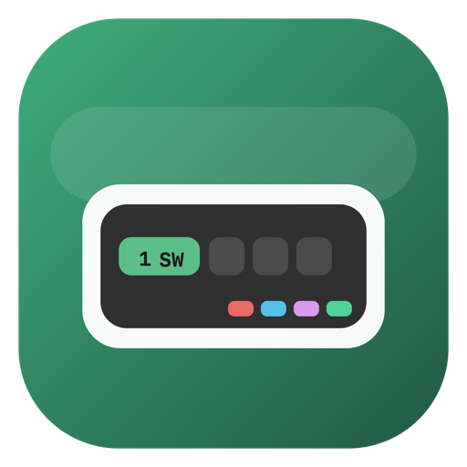

<div align="center">



# SmartWindow

**Your windows, music, and system status. One macOS bar.**

A native SwiftUI menu bar overlay inspired by Polybar and Waybar.<br/>
Switch windows by number, keep your music in sight, and make the bar yours.

[](https://github.com/kevnnard/smart-window/releases/tag/v0.2.0)
[](#requirements)
[](#quick-start)
[](LICENSE)

[Quick start](#quick-start) · [Features](#features) · [Settings](#settings) · [Shortcuts](#keyboard-shortcuts) · [Build from source](#build-from-source)

</div>

<p align="center">
  
</p>

<p align="center">
  
</p>

> **Release vs. development:** the published release linked here is **v0.2.0**.
> The features below describe the current source, including unreleased improvements
> to Now Playing, hardware readings, Settings, and Tailscale. Build from source to
> try those changes; do not assume the Homebrew release includes them yet.
> The screenshots above are existing project images, not a preview of every new setting.

---

## Quick start

### Install the published app

```bash
brew tap kevnnard/tap
brew install --cask smartwindow
```

1. Open **SmartWindow** from Applications.
2. Grant **Accessibility** access in System Settings → Privacy & Security → Accessibility.
3. Click a window tab or press **Option + 1–9** to switch windows.

SmartWindow runs as a menu bar utility, without a Dock icon. Open its menu bar
popover and choose **Open Settings** to customize it.

<details>
<summary>Upgrade or uninstall</summary>

```bash
# Upgrade the published app
brew update
brew upgrade --cask smartwindow

# Uninstall
brew uninstall --cask smartwindow
```

Homebrew installs the release bundle into `/Applications/SmartWindow.app`.

</details>

## Why SmartWindow?

Window switching should be direct, not a search through overlapping apps.
SmartWindow gives each open window a numbered tab and brings the essentials into
one compact bar, without asking you to adopt a tiling window manager.

- **Find the right window:** readable tabs, click-to-focus, and global shortcuts.
- **Keep context visible:** music, hardware readings, and timezones alongside your windows.
- **Fit your desktop:** per-monitor bars, fullscreen awareness, and optional widgets.

SmartWindow draws above the native menu bar; it does not replace macOS system menus
or automatically tile your windows.

## Features

### Window switching

Numbered tabs such as `1 · Finder`, `2 · Ghostty`, and `3 · Safari` let you focus a
window with a click or a shortcut. Each monitor gets its own bar, and entering
fullscreen hides the bar only on the affected screen.

Tabs size to their app names within readable bounds, with consistent spacing and
no width jump when selected. Hover a tab to see its full window title, including
when multiple windows belong to the same app. When tabs no longer fit, `+N` opens
a searchable list of all windows. Search by app or window title; Return selects
the first result. Original ordering, tab numbers, and ⌥1–9 shortcuts are preserved.

When Finder has no ordinary window to focus, selecting its desktop entry opens
the Desktop folder instead of doing nothing.

### Focus mode

Click the **moon** in the bar to hide secondary widgets on every display, leaving
window tabs, the clock and music. Click again to restore your global and per-display
widget choices, unchanged. The moon remains available so you can leave focus mode.
This setting persists across relaunches and is also available in Settings → General.

### Now Playing

A compact badge sits around the MacBook notch or below the top edge on displays
without a notch.

- **Spotify and Apple Music:** track title and artist, with Spotify artwork when available.
- **Playing or paused:** animated activity while playing, a pause indicator when paused.
- **Persistent presence:** the badge stays while a supported player is open and disappears when it quits.
- **Click to return:** click the artwork, title, or artist to bring the player forward.
- **Playback controls:** click the waveform / pause indicator for previous, play/pause,
  and next. Controls target the running supported player; failures are shown in the popover.
- **Readable by design:** long text scrolls only when needed; the badge is black by default.

Automation permission is required. Browser media such as YouTube in Chrome or
Safari is **not supported** by the current player integration.

### System widgets

Choose which widgets to show, drag to reorder them, and add separators in Settings.

| Widget | What it reports | Important detail |
|:---|:---|:---|
| CPU | Usage calculated between processor tick samples | Not an average since boot |
| Memory | System memory usage | Displayed as a percentage |
| GPU | IOAccelerator device utilization | Availability depends on hardware and driver |
| Temperature | Readable CPU / GPU die sensors and macOS thermal state | Shows `--` when temperature is unavailable; Celsius or Fahrenheit |
| Microphone | Whether an input device is running | Device activity, not the configured input volume |
| Volume | Default output device volume and mute state | Shows a percentage, `MUTE`, or `--` when software volume is unsupported |
| Battery | Charge level and charging state | Depends on the Mac's battery hardware |
| Tailscale | Tailnet state and observed online duration | Optional; see [Tailscale](#tailscale) |
| Keyboard input | Active macOS keyboard input source | Click to switch between enabled sources; see [Keyboard input](#keyboard-input) |
| Clock | Date, time, and extra timezones | The clock remains at the far right |

Temperature uses private IOHID interfaces, so sensor support can vary between Macs
and macOS releases. An unavailable temperature or software volume is not replaced
with a made-up reading.

## Settings

A resizable window with a System Settings-style sidebar keeps controls grouped by purpose.

| Pane | Controls |
|:---|:---|
| **General** | Shortcut reference, app version, and Accessibility permission status |
| **Appearance** | Bar opacity from 60–100%, black or bar-colored Now Playing badge, and a live preview |
| **Widgets** | Global visibility, drag-to-reorder, separators, and temperature unit |
| **Displays** | Per-monitor widget and Now Playing visibility: Default, Show, or Hide |
| **Clock** | Displayed timezone and searchable extra timezones |
| **Tailscale** | Installation / connection status, tailnet details, and the widget toggle |

The bar defaults to a neutral dark surface at **94% opacity**; the Now Playing
badge defaults to **black**. Appearance and widget preferences persist between launches.

**Launch at login** registers the installed app with macOS Login Items using
`SMAppService`. macOS may require approval in System Settings; the General pane
shows that state and offers a link. Registration errors do not turn into a fake
successful toggle. This control is unavailable in an unbundled debug executable.
An old saved startup preference does not automatically register the app.

In **Displays**, choose a connected monitor and override each widget or Now Playing.
**Default** follows global settings; **Show** and **Hide** take precedence on that
monitor. Overrides use the display's CoreGraphics UUID and are retained across
reconnection. Widget order, clock settings and separators remain global.
"Use Defaults for This Display" resets only that monitor's overrides. Disabling
"Show Now Playing by default" still allows explicit Show on a chosen monitor.

## Keyboard input

Enable **Keyboard input** in Settings → Widgets to show the active macOS keyboard
input source. Click the widget to open a native menu with the same enabled keyboard
sources and localized names used by the system Input menu; the active one is checked.
For example, **U.S.** appears as `US` in the bar and **Latin American** as `LAT`.
Other sources use a shortened name, with the full name in the menu and tooltip.

Selection uses macOS Text Input Source Services. Changing the source in the system
Input menu or with a macOS shortcut also updates the widget. SmartWindow does not
install or enable keyboard layouts, change your source list, or change the app's
interface language. The optional widget starts hidden and can be reordered like
other widgets.

## Tailscale

Already using [Tailscale](https://tailscale.com/)? Enable **Show Tailscale widget**
in Settings → Tailscale. It is optional and starts hidden. If Tailscale is not
installed, the pane links to the official macOS download and the widget stays hidden.

| Display | Meaning |
|:---|:---|
| Elapsed time, such as `1h 23m` | SmartWindow has continuously observed Tailscale online |
| `OFF` | Stopped, logged out, or awaiting authorization |
| `…` | Connecting |
| `--` | Status could not be read |

The service reads `tailscale status --json` every **five seconds**, using the
standard `/Applications/Tailscale.app` CLI or the Homebrew CLI locations
`/opt/homebrew/bin/tailscale` and `/usr/local/bin/tailscale`. Monitoring is read-only:
SmartWindow does not connect, disconnect, install, or reconfigure your VPN.

**The timer is observed online time, not the tunnel's actual connection age.**
It resets after disconnection, unavailable status, sleep, a long polling gap, or
restarting SmartWindow. Brief state changes between checks may be missed.

Tailscale provides encrypted connections within your tailnet. Being connected
**does not mean all internet traffic goes through a VPN**; that requires a
separately configured exit node.

## Keyboard shortcuts

| Shortcut | Action |
|:---|:---|
| `Option + Escape` | Show / hide SmartWindow |
| `Option + ]` | Focus next window |
| `Option + [` | Focus previous window |
| `Option + 1–9` | Focus tab by number |

Shortcuts are global, so you can use them while another app is focused.

## Requirements

- **macOS 13 or newer.** Development is primarily on Apple Silicon and macOS beta builds; Intel compatibility is not comprehensively verified.
- **Accessibility permission** for listing and focusing windows.
- **Automation permission** for Spotify / Apple Music integration.
- **Swift 5.9+ toolchain** when building from source.
- **Tailscale is optional**, required only for its widget.

### Permissions and troubleshooting

| Symptom | What to check |
|:---|:---|
| Windows are missing or tabs do not focus them | Enable SmartWindow in System Settings → Privacy & Security → Accessibility |
| No Now Playing badge with a supported player running | Approve SmartWindow's request to control Spotify or Music under Privacy & Security → Automation |
| Volume shows `--` | Some HDMI / DisplayPort outputs expose no software volume control |
| Temperature shows `--` | The current Mac or macOS version may not expose a readable sensor |
| No Tailscale widget | Enable it in Settings and check that Tailscale is installed in a supported CLI location |
| Tailscale shows `--` | Open Tailscale and check its status; a failed, malformed, or timed-out CLI response is treated as unavailable |

macOS prompts for Automation access when SmartWindow queries a running supported
player. Without permission, that player's metadata cannot be read. When macOS
blocks a downloaded app, review the warning in Privacy & Security; do not disable
system security protections to run it.

## Build from source

From the repository root:

```bash
swift build
swift run SmartWindow
```

To open Settings at launch:

```bash
swift run SmartWindow --settings
```

A development executable is not a signed app bundle: its icon, version label, and
permission behavior can differ from the installed app.

### Install a local app bundle

```bash
./scripts/install-app.sh
```

This builds a release bundle and **replaces** `/Applications/SmartWindow.app`.
To create the repository-local bundle without replacing the installed app:

```bash
SMARTWINDOW_SKIP_INSTALL=1 ./scripts/install-app.sh
```

Signing is optional for local builds. When a signing identity is supplied, the
installer uses `Resources/SmartWindow.entitlements` by default, including the
Apple Events entitlement needed for player automation.

### Verification

The package currently has no automated SwiftPM test target. The Tailscale probe
covers state parsing, duration boundaries, bounded subprocess handling, and the
sleep-reset notification without changing VPN state:

```bash
swiftc Sources/Services/TailscaleService.swift Tests/Probes/TailscaleProbe.swift -o .build/tailscale-probe
.build/tailscale-probe
```

The keyboard probe checks native source listing, labels, and rejection of an
unknown source without changing the active keyboard:

```bash
mkdir -p .build/probes
swiftc Sources/Services/KeyboardInputService.swift Tests/Probes/KeyboardInputProbe.swift -o .build/probes/keyboard-input-probe
.build/probes/keyboard-input-probe
```

For a live selection and notification check, add `--switch`. This requires two
enabled keyboard sources, briefly changes the active source, and restores the
original source when the check returns, including on reported failures:

```bash
.build/probes/keyboard-input-probe --switch
```

Desktop-controls probes use fake login/player executors and isolated preference
suites; they do not register login items, change playback, or overwrite your settings:

```bash
mkdir -p .build/probes
swiftc Sources/Services/LoginItemService.swift Tests/Probes/LoginItemProbe.swift -o .build/probes/login-item-probe
.build/probes/login-item-probe
swiftc Sources/Services/NowPlayingService.swift Tests/Probes/NowPlayingControlsProbe.swift -o .build/probes/media-controls-probe
.build/probes/media-controls-probe
swiftc Sources/Models/WindowOverflowPolicy.swift Tests/Probes/WindowOverflowProbe.swift -o .build/probes/overflow-probe
.build/probes/overflow-probe
swiftc Sources/Models/DisplayPreferences.swift Tests/Probes/DisplayPreferencesProbe.swift -o .build/probes/displays-probe
.build/probes/displays-probe
swiftc Sources/Models/FocusMode.swift Sources/Models/DisplayPreferences.swift Tests/Probes/FocusModeProbe.swift -o .build/probes/focus-probe
.build/probes/focus-probe
```

Hardware readings, player permissions, and UI behavior still need checks on a real
Mac. Physical-notch geometry has not yet been verified live; recent visual checks
used an external display.

<details>
<summary><strong>Repository map</strong></summary>

```text
SmartWindow/
├── Package.swift                  # macOS executable and dependencies
├── Resources/                     # App icon, Info.plist, Apple Events entitlement
├── Sources/
│   ├── App/                       # Lifecycle, settings window, global shortcuts
│   ├── Models/                    # Window models and persisted settings
│   ├── Services/                  # Accessibility, metrics, media, Tailscale
│   └── Views/
│       ├── Components/            # Window tabs and status widgets
│       ├── Notch/                 # Per-screen Now Playing layout and panel
│       ├── SettingsView.swift     # Settings sidebar and panes
│       └── TabBarView.swift       # Main bar composition
├── Tests/Probes/                  # Standalone verification probes
└── scripts/                       # Local app install and release tooling
```

</details>

<details>
<summary><strong>Maintainer release workflow</strong></summary>

Publishing is separate from building or installing locally. From a **clean working
tree**, the release helper builds the ZIP, publishes a GitHub release, and commits
and pushes the Homebrew cask update. It expects a sibling `../homebrew-tap` repository.

```bash
# Replace the version and notes with the intended release.
./scripts/release-homebrew.sh 0.2.0 "Release notes here"
```

For signed, notarized releases, set your own identity and profile:

```bash
export SMARTWINDOW_CODESIGN_IDENTITY="Developer ID Application: Your Name (TEAMID)"
export SMARTWINDOW_NOTARY_PROFILE="smartwindow-notary"
```

Create the notary profile once:

```bash
xcrun notarytool store-credentials "smartwindow-notary" \
  --apple-id "you@example.com" \
  --team-id "TEAMID" \
  --password "app-specific-password"
```

The helper signs when `SMARTWINDOW_CODESIGN_IDENTITY` is set, notarizes and staples
when `SMARTWINDOW_NOTARY_PROFILE` is set, computes the ZIP checksum, pushes this
repository, creates or updates the release tag, and updates `kevnnard/homebrew-tap`.

Use `scripts/release-env.example.sh` as a template for local signing configuration.
The same signing identity variable also applies to `scripts/install-app.sh`.

</details>

## Roadmap

- Verify physical-notch layout on an open MacBook display.
- Improve overflow behavior with many window tabs.
- Expand hardware and macOS compatibility checks.
- Publish the current development improvements in a follow-up release.

## License

**Source-available, free for non-commercial use.**

Under the [SmartWindow Public Non-Commercial License v1.1](LICENSE):

- **You may** use, study, compile, modify, and share copies for free for personal,
  educational, research, and other non-commercial purposes.
- **You must** preserve the license and copyright notices, share under the same
  terms, and clearly identify modified versions.
- **You may not** sell, resell, monetize access to, or otherwise commercially
  exploit the app or modified versions without prior written permission from
  the copyright holder. This includes bundling it into paid products or services.
- **The copyright holder retains** the right to sell SmartWindow or grant
  separate commercial licenses for the work they own.

Source availability is not permission for commercial use. This is a custom
non-commercial, source-available license, not an open-source license.
Third-party components remain subject to their own licenses.
The full terms in `LICENSE` govern; this section is a summary.

Copyright © 2026 Kevnnard.
