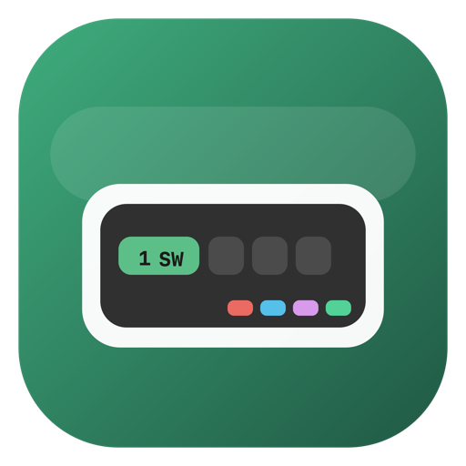
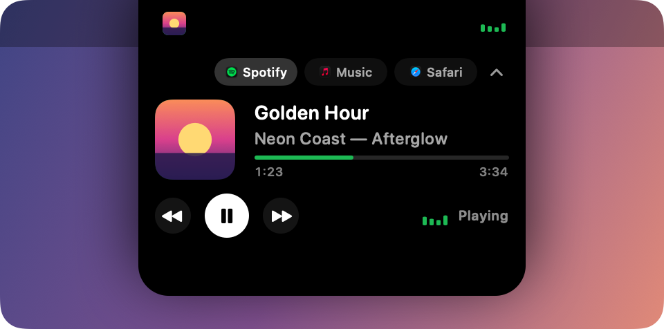
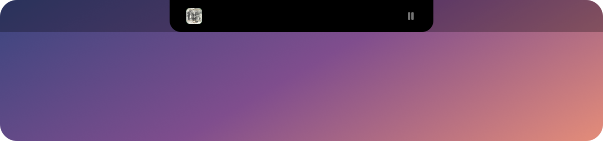
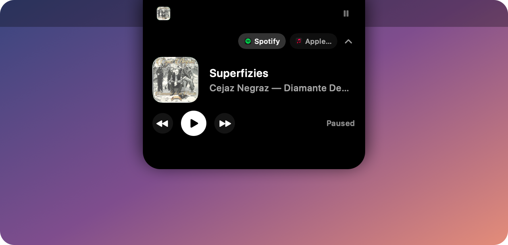
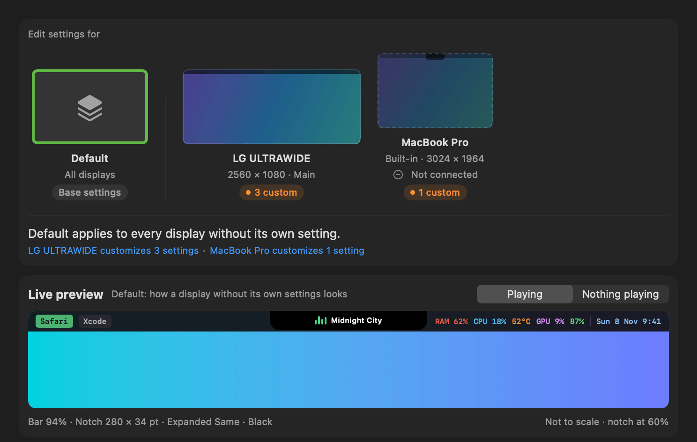
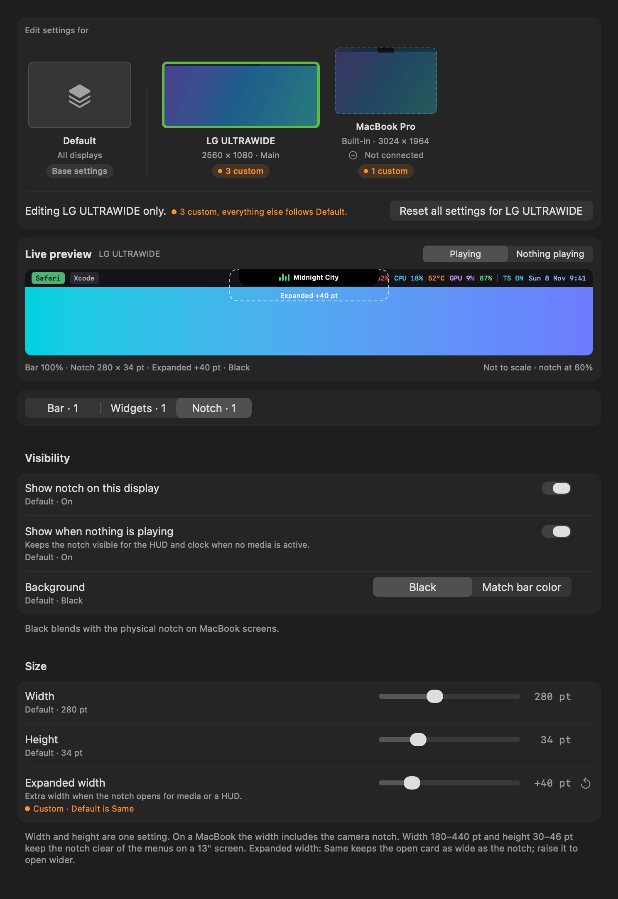
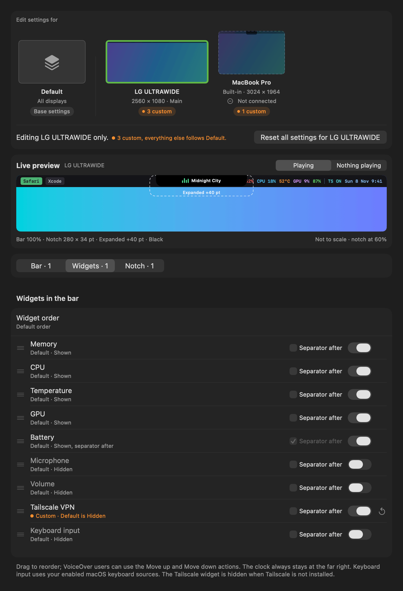

<div align="center">



# SmartWindow

**Your MacBook notch, finally useful. Plus a window bar that keeps everything one click away.**

Music, volume, brightness and Focus live around the camera notch.<br/>
Numbered window tabs and system widgets live in a slim bar on top of every screen.

[](https://github.com/kevnnard/smart-window/releases/tag/v0.5.0)
[](#requirements)
[](#requirements)
[](#install)
[](#license)

[Install](#install) · [The notch](#the-notch) · [The bar](#the-bar) · [Settings](#settings) · [Shortcuts](#keyboard-shortcuts) · [FAQ](#troubleshooting)

</div>

<p align="center">
  
</p>

---

## Install

```bash
brew install --cask kevnnard/tap/smartwindow
```

1. Open **SmartWindow** from your Applications folder.
2. When asked, allow **Accessibility** in System Settings → Privacy & Security → Accessibility.
   This is the only permission SmartWindow needs.
3. That's it. The notch appears around your camera, and the bar appears at the top of each screen.

SmartWindow lives in the menu bar and has no Dock icon. Click its menu bar icon and
choose **Open Settings** to customize it.

> The release is a signed and notarized build for **Apple Silicon** Macs running
> **macOS 13 or later**. On an Intel Mac, [build it from source](CONTRIBUTING.md).

### Optional permissions

Each one turns on one extra feature. You can skip any of them and grant it later from
**Settings → Permissions**, which shows what is granted and has a button for each.

| Permission | What it turns on | How you grant it |
|:---|:---|:---|
| **Automation: Spotify / Music** | Showing and controlling what Spotify and Music play | macOS asks the first time SmartWindow talks to the app |
| **Full Disk Access** | The **name and icon** of the Focus you turn on or off | Add SmartWindow by hand in System Settings → Privacy & Security → Full Disk Access (macOS has no prompt for this) |
| **Focus Status** | A generic "Focus on" when Full Disk Access is not granted | macOS asks; or click **Allow…** in Settings → Permissions |

Why Full Disk Access? macOS keeps the name of the active Focus in a protected folder.
SmartWindow only reads that Focus information; without it, you still see a generic Focus.

<details>
<summary>Upgrade or uninstall</summary>

```bash
brew upgrade --cask smartwindow     # upgrade
brew uninstall --cask smartwindow   # uninstall
```

After an upgrade, macOS sometimes keeps an old Full Disk Access entry. If Focus stops
showing in the notch, see [Troubleshooting](#troubleshooting).

</details>

---

## The notch

SmartWindow turns the black notch around your MacBook camera into a small, live
status area. It stays pure black, so it blends with the camera housing, and nothing
is ever drawn over the camera itself.

### Now Playing, at a glance

While music or video plays, the notch shows the artwork on one side of the camera
and a playing indicator on the other.

<p align="center">
  
</p>

Make the notch wider in Settings and the title, artist and app name fit next to it.

### Open the drawer

**Hover or click** the notch and a drawer opens right below it. The compact row stays
exactly where it is; the details slide in underneath. Move the pointer away and the
drawer closes on its own.

In the drawer you get:

- **Artwork, title, artist and album**: click the artwork to bring the player to the front.
- **A progress bar** with elapsed and total time, when the app reports them.
- **Previous, play/pause and next** buttons.
- **One badge per app** that is playing. Pick a badge to choose which app the notch follows.

<p align="center">
  
</p>

### Every source, not only Spotify

SmartWindow reads everything macOS lists as **Now Playing**: Spotify, Music, and media
in browsers such as YouTube in Safari or Chrome. With several apps playing at once,
each one gets its own badge. Paused browser tabs don't get a badge.

### Controls you can trust

- **Spotify and Music** are controlled directly.
- **Any other app** is controlled only while macOS reports it as the Mac's current
  Now Playing app. When it isn't, the buttons are dimmed and the drawer tells you why,
  instead of sending your click to the wrong app.

macOS has no way to target one specific app, so if the current Now Playing app changes
in the instant before you click, that click can reach the new one.

### Volume, brightness and mute

Change the volume or the screen brightness and the notch **spreads out sideways** for a moment:
an icon on the left of the camera, the level on the right. It never grows downward,
so it never covers the window below. It also shows when nothing is playing.

<table align="center">
  <tr>
    <td align="center"><br/><sub>Volume</sub></td>
    <td align="center"><br/><sub>Brightness</sub></td>
  </tr>
  <tr>
    <td align="center" colspan="2"><br/><sub>Muted</sub></td>
  </tr>
</table>

Good to know:

- The regular macOS volume and brightness overlay still appears too.
- **Volume** shows for outputs that have a software volume. Monitors that get audio
  over DisplayPort or HDMI usually don't, so there is no level to show.
- **Brightness** shows for the built-in display only.
- While the drawer is open, it takes priority and the HUD waits.

### Focus on and off

Turn a Focus on or off and the notch tells you which one, with its icon in its own
color.

<table align="center">
  <tr>
    <td align="center"><br/><sub>Focus turned on</sub></td>
    <td align="center"><br/><sub>Focus turned off</sub></td>
  </tr>
</table>

Showing the Focus **name** needs [Full Disk Access](#optional-permissions). Without it,
SmartWindow uses Focus Status and shows a generic **Focus** instead. A Focus turned on
by a schedule may show only as the generic Focus, and only when Focus Status is allowed.

### On external monitors too

Displays without a camera notch get the same notch, hanging from the top edge of the
screen. There is room for the title and artist right in the pill, and the volume and
Focus HUD appear there as well.

<p align="center">
  
</p>
<p align="center">
  
</p>

### Stays out of your way

- **Clicks pass through** the empty space around the notch, so windows and menus
  below it keep working.
- **Your size, per monitor**: set the width, height and how much wider the drawer
  opens, for all displays or for one in particular.
- **Your choice of look**: pure black (the default, matches the camera) or the bar's color.
- **Hide it** on any monitor, or show it only while something is playing.

---

## The bar

A slim bar sits on top of every screen with your open windows on the left and your
system status on the right. It draws above the macOS menu bar; it doesn't replace the
system menus or move your windows around.

<p align="center">
  
</p>
<p align="center">
  
</p>

### Numbered window tabs

Every open window gets a tab like `1 · Finder`, `2 · Ghostty`, `3 · Safari`.
**Click a tab** or press **⌥1–⌥9** to jump straight to it.

- **Hover a tab** to see the full window title, handy when one app has several windows.
- **Too many windows?** A `+N` button opens a searchable list. Type an app or window
  name and press Return.
- **Fullscreen apps**: the bar hides only on the screen that went fullscreen.
- **Finder without windows**: its tab opens your Desktop folder.

### Focus mode

Click the **moon** in the bar to hide the secondary widgets on every display, leaving
just your window tabs, the clock and your music. Click it again to bring everything
back exactly as it was. (This is SmartWindow's own focus mode, separate from macOS Focus.)

### System widgets

Pick the widgets you want, drag them into your order, and add separators between them.

| Widget | Shows |
|:---|:---|
| **CPU** | Current processor usage |
| **Memory** | Memory in use, as a percentage |
| **GPU** | Graphics usage, when your Mac reports it |
| **Temperature** | CPU / GPU temperature in °C or °F, `--` if your Mac doesn't expose a sensor |
| **Battery** | Charge level and whether it's charging |
| **Microphone** | Whether a microphone is in use right now |
| **Volume** | Output volume, `MUTE`, or `--` when the output has no software volume |
| **Keyboard input** | Your current keyboard layout, such as `US` or `LAT`. Click to switch |
| **Tailscale** | Whether your tailnet is online, and for how long |
| **Clock** | Date and time. Click it to switch between your extra time zones |

The clock always stays at the far right. SmartWindow never fakes a reading: when a
value isn't available, you see `--`. Temperature sensors vary between Macs and macOS
versions, so that widget may not work everywhere.

<details>
<summary><strong>More about Keyboard input</strong></summary>

The widget shows the keyboard source macOS is using. Click it to get the same list as
the system Input menu and switch with one click. Changing the source from the Input
menu or with a keyboard shortcut updates the widget too. SmartWindow never adds,
removes or enables keyboard layouts for you.

</details>

<details>
<summary><strong>More about Tailscale</strong></summary>

Already use [Tailscale](https://tailscale.com/)? Turn on its widget in
Settings → Bar & Notch → Widgets. If Tailscale isn't installed, the widget stays hidden
and the Tailscale page links to the official download.

| You see | It means |
|:---|:---|
| A time, like `1h 23m` | Online for that long, as seen by SmartWindow |
| `OFF` | Stopped, logged out, or waiting for you to sign in |
| `…` | Connecting |
| `--` | Status couldn't be read |

SmartWindow checks every five seconds using the Tailscale app's command-line tool, or a
Homebrew install in `/opt/homebrew/bin` or `/usr/local/bin`. It only reads the status;
it never connects, disconnects or changes your VPN.
The timer counts how long SmartWindow has seen Tailscale online, so it restarts after a
disconnection, sleep, or relaunching SmartWindow. Being on your tailnet doesn't mean
all your traffic goes through a VPN; that needs an exit node.

</details>

### A bar per monitor

Each monitor gets its own bar, and each one can have its own widgets and opacity.
On a MacBook screen, widgets that don't fit beside the notch scroll sideways while the
clock stays visible at the right edge.

---

## Settings

Open Settings from the SmartWindow menu bar icon. The sidebar has two groups:
**Displays** for everything that can differ per monitor, and **App** for what applies
everywhere.

### Bar & Notch

This page starts with a **map of your monitors** and a live preview.

<p align="center">
  
</p>

- Choose **Default** to set how every monitor looks.
- Choose a **monitor** to customize just that one. Anything you change there is marked
  **Custom**, with a button to put it back to Default. **Reset all settings for…** clears
  every customization for that monitor.
- A monitor that's unplugged keeps its settings. It shows up dashed as **Not connected**,
  and you can still edit it.
- With only one monitor, the map is hidden and you edit Default directly.

Below the map, three tabs hold the settings:

| Tab | What you can change |
|:---|:---|
| **Bar** | Bar opacity (60–100%) |
| **Widgets** | Which widgets show, their order, and separators |
| **Notch** | Show the notch on this display, show it when nothing is playing, black or bar-colored background, width, height, and how much wider the drawer opens |

<table align="center">
  <tr>
    <td align="center"><br/><sub>Notch tab, customized for one monitor</sub></td>
    <td align="center"><br/><sub>Widgets tab</sub></td>
  </tr>
</table>

### App settings

| Page | What's there |
|:---|:---|
| **General** | Launch at login, Focus mode, temperature unit, a shortcut reference, and the app version |
| **Clock** | The time zone shown in the bar, plus extra time zones you can click through |
| **Tailscale** | Whether Tailscale is installed and connected, and your tailnet details |
| **Permissions** | Accessibility (required) and the optional permissions, whether each is granted, and a button to grant it |

**Launch at login** uses macOS Login Items. If macOS asks for approval, the General page
says so and links you to the right place.

All settings are saved and restored between launches.

---

## Keyboard shortcuts

| Shortcut | Action |
|:---|:---|
| `⌥ Esc` | Show / hide SmartWindow |
| `⌥ ]` | Next window |
| `⌥ [` | Previous window |
| `⌥ 1` … `⌥ 9` | Jump to tab 1 to 9 |

Shortcuts work from any app.

---

## Requirements

- An **Apple Silicon** Mac with **macOS 13 or later** for the Homebrew release.
  Intel Macs can [build from source](CONTRIBUTING.md); Intel isn't fully tested.
- **Accessibility** permission, to list and switch windows.
- Optional: **Automation** for Spotify / Music, **Full Disk Access** or **Focus Status**
  for Focus, and **Tailscale** for its widget. See [Optional permissions](#optional-permissions).

The notch was checked on a 14" MacBook Pro next to an external monitor. Other MacBook
sizes haven't been checked yet.

---

## Troubleshooting

| Problem | Try this |
|:---|:---|
| Windows are missing or tabs don't switch | Turn on SmartWindow in System Settings → Privacy & Security → **Accessibility** |
| Spotify or Music controls do nothing | Allow SmartWindow under Privacy & Security → **Automation** |
| The play buttons are dimmed for a browser or other app | That app isn't the Mac's current Now Playing app right now; the drawer shows the reason |
| **Focus doesn't show in the notch** after installing or upgrading | Remove SmartWindow from **Full Disk Access**, add it again, then quit and reopen SmartWindow |
| Focus shows as a generic "Focus" | Grant **Full Disk Access** to see its name and icon |
| No volume HUD, or Volume shows `--` | Your output (often a monitor on DisplayPort or HDMI) has no software volume |
| No brightness HUD on an external monitor | Brightness is shown for the built-in display only |
| Temperature shows `--` | Your Mac or macOS version doesn't expose a readable sensor |
| No Tailscale widget | Turn it on in Settings → Bar & Notch → Widgets, and check that Tailscale is installed |
| I have an Intel Mac | The Homebrew release is Apple Silicon only; [build from source](CONTRIBUTING.md) |

If macOS blocks the app, check the message in Privacy & Security. Don't turn off system
security protections to run it.

---

## Contributing

Want to build SmartWindow yourself, run the checks, or help out? Everything for
developers is in **[CONTRIBUTING.md](CONTRIBUTING.md)**.

## License

**Source-available, free for non-commercial use.**

Under the [SmartWindow Public Non-Commercial License v1.1](LICENSE):

- **You may** use, study, compile, modify, and share copies for free for personal,
  educational, research, and other non-commercial purposes.
- **You must** keep the license and copyright notices, share under the same terms,
  and clearly mark modified versions.
- **You may not** sell, resell, monetize access to, or otherwise commercially exploit
  the app or modified versions without prior written permission from the copyright
  holder. This includes bundling it into paid products or services.
- **The copyright holder keeps** the right to sell SmartWindow or grant separate
  commercial licenses for the work they own.

This is a custom source-available license, not an open-source license. The full terms
in [`LICENSE`](LICENSE) govern; this section is a summary.

Now Playing sessions are read with the help of
[mediaremote-adapter](Vendor/mediaremote-adapter/LICENSE), used under its own
BSD-3-Clause license.

Copyright © 2026 Kevnnard.
